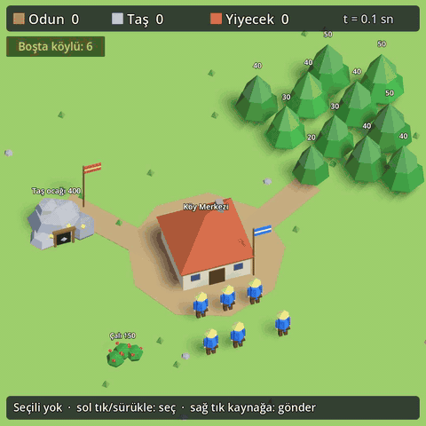
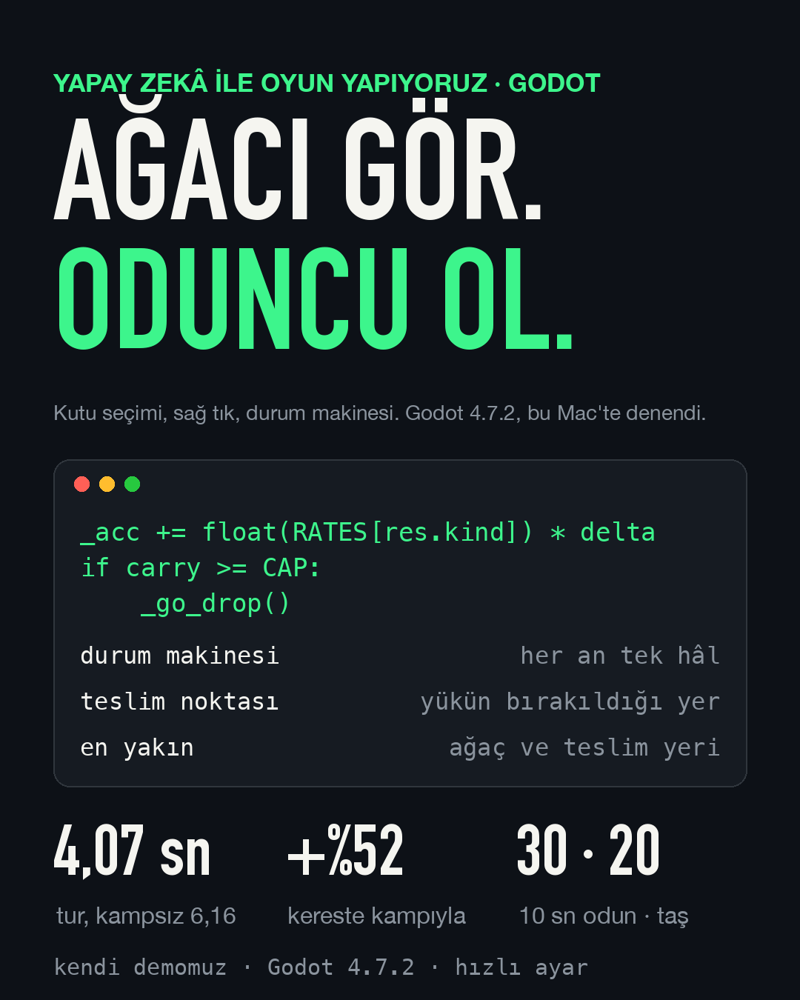

# Godot 4: köylüyü oduncu yap (strateji oyunu kaynak toplama)

Kutuyla köylü seç, ağaca sağ tıkla: köylüler oduncu olur, ağaca yürür, keser, 10 odunu en yakın teslim noktasına taşır, döner ve tekrarlar. Taş ocağı için aynısı. Ağaç bitince en yakın ağaca kendiliğinden geçerler; boştaki köylüyü düğmeyle bulup gönderebilirsin. Her şey kodla, Godot'nun hazır şekilleriyle çizildi (dış varlık yok).

Köylü bir durum makinesi: boşta → kaynağa yürü → topla → teslim noktasına yürü → bırak → tekrar.



[▶ Adım adım anlatımlı video: video.mp4](video.mp4)



[▶ Tam kalite video: demo.mp4](demo.mp4)

`demo.mp4`: 3 oduncu + 3 taşçı, sayaçlar 0'dan Odun 30 · Taş 20'ye.

## Çalıştır

```bash
# godot/project.godot → Çalıştır: sol tık/sürükle seç, sağ tık kaynağa gönder
godot --path godot -- --auto-rts            # tıklamalar kodla
godot --headless --path godot --fixed-fps 60 --quit-after 3601 -- --auto-rts --summary-at=60          # kampsız ölçüm
godot --headless --path godot --fixed-fps 60 --quit-after 3601 -- --auto-rts --camp --summary-at=60   # ormanın yanında kamp
```

## Ölçtüklerimiz (Godot 4.7.2, macOS)

Video 10 sn'ye sığsın diye hızlar artırıldı: yürüme 3,5 m/sn, kesme 5 odun/sn, kazma 4 taş/sn, taşıma 10.

| | Kamp yok | Ormanın kenarında kamp |
|---|---|---|
| Oduncunun bir turu | 6,16 sn | 4,07 sn (−%34) |
| Köylü başına odun | 97,4 / dk | 147,6 / dk (+%52) |
| 430 odunluk orman biter | 88,3 sn | 61,2 sn |

Kesme süresi değişmiyor (2,00 sn); kamp yalnız yürüyüşü kısaltıyor.
